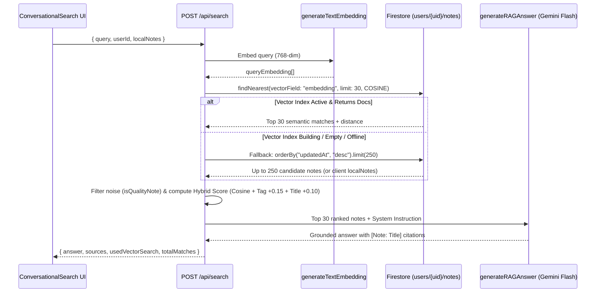
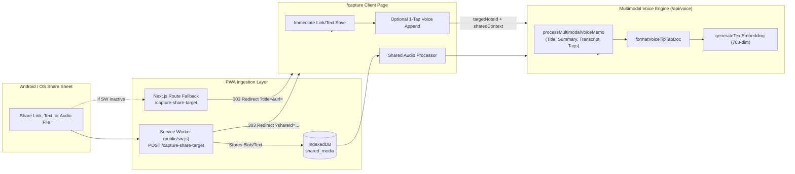

# AI, RAG Search & Capture Pipelines

This document details the three core intelligence and ingestion pipelines in `gBrain`:
1. **Vector Embedding Pipeline (`/api/embed`)**
2. **Hybrid Vector Search & Conversational RAG Pipeline (`/api/search`, `/api/rag`, `/api/chat`)**
3. **Universal Share Target & Multimodal Voice Pipeline (`/capture-share-target`, `/capture`, `/api/voice`)**

---

## 1. Vector Embedding Pipeline (`POST /api/embed`)

### Trigger Points
* **Client Auto-Save:** [`saveNote()`](file:///Users/gustavo/dev/projects/gBrain/src/lib/notes/notes-service.ts#L155-L194) checks if `plain_text` is non-empty and changed since the last save (`previousPlainText !== note.plain_text || !note.embedding`). If so, it fires a non-blocking `POST /api/embed`.
* **Voice Memo Creation:** [`POST /api/voice`](file:///Users/gustavo/dev/projects/gBrain/src/app/api/voice/route.ts#L78-L79) synchronously embeds the combined title + summary + transcript before writing the voice note.
* **Google Keep Seeding:** [`POST /api/seed`](file:///Users/gustavo/dev/projects/gBrain/src/app/api/seed/route.ts#L198-L204) embeds imported notes in batches of 5.

### Multi-Tier Embedding Strategy ([`generateTextEmbedding`](file:///Users/gustavo/dev/projects/gBrain/src/lib/firebase/admin.ts#L202-L267))
To ensure reliability across Cloud Run (ADC), API-key environments, and offline local testing, `generateTextEmbedding` sanitizes input text (`sanitizeTextForGemini`, max 20,000 chars) and attempts:
1. **Tier 1 (Direct Gemini REST API):** If `GEMINI_API_KEY` or `GOOGLE_API_KEY` is set, calls `models/gemini-embedding-001:embedContent` with `outputDimensionality: 768`.
2. **Tier 2 (Vertex AI ADC):** Uses `getVertexAIGenAIClient()` (`@google/genai` with `vertexai: true`, location `us-central1`) to call `text-embedding-004` (natively 768 dimensions).
3. **Tier 3 (Deterministic Mock Fallback):** If GCP credentials or network are unavailable in local dev, [`generateDeterministicMockEmbedding`](file:///Users/gustavo/dev/projects/gBrain/src/lib/firebase/admin.ts#L184-L197) produces a normalized 768-dimensional float vector so vector math and local flows never crash.

### Firestore Persistence
* [`src/app/api/embed/route.ts`](file:///Users/gustavo/dev/projects/gBrain/src/app/api/embed/route.ts#L47-L65) writes `embedding: FieldValue.vector(embedding)` (falling back to a raw `number[]` array if the SDK version or emulator rejects `VectorValue`), along with `hasEmbedding: true` and `embeddingUpdatedAt`.

---

## 2. Hybrid Vector Search & RAG Pipeline (`POST /api/search`)

> **Note:** [`/api/rag/route.ts`](file:///Users/gustavo/dev/projects/gBrain/src/app/api/rag/route.ts) and [`/api/chat/route.ts`](file:///Users/gustavo/dev/projects/gBrain/src/app/api/chat/route.ts) directly re-export `POST` from [`/api/search/route.ts`](file:///Users/gustavo/dev/projects/gBrain/src/app/api/search/route.ts).

### Key Pipeline Rules (Core Architectural Rule 2)
1. **No Database Pre-Filtering:** `findNearest` is never combined with `.where()` tag or date filters in Firestore to avoid rigid composite vector index requirements.
2. **Quality Filtering (`isQualityNote`):** Filters out stub notes shorter than 15 characters or legacy placeholder notes containing `"Full multimodal transcription deferred"`.
3. **Hybrid Re-Ranking:**
   * **Base Score:** `1 - cosineDistance` (from `findNearest`) or computed in-memory via `cosineSimilarity(queryEmbedding, note.embedding)` (or keyword frequency fallback if unembedded).
   * **Tag Boost (`+0.15`):** Applied when any non-stopword in the user's query matches one of the note's `#tags`.
   * **Title Boost (`+0.10`):** Applied when any query keyword appears in the note's title.
4. **Grounded Synthesis (`generateRAGAnswer`):**
   * Formats the top 30 ranked notes as `[Note i: Title]\nPlain Text` blocks.
   * Instructs Gemini to group insights conceptually, ground all claims strictly in the provided notes, and cite every claim with `[Note: Title]`.
   * Tries Direct REST (`GEMINI_API_KEY`) → Vertex AI ADC (`CANDIDATE_GEMINI_MODELS`) → AI Studio SDK. Throws a `SynthesisError` rather than returning a fake template if all models fail.

---

## 3. Universal Capture & Multimodal Voice Pipeline

### A. Web Share Target Flow
1. [`public/manifest.json`](file:///Users/gustavo/dev/projects/gBrain/public/manifest.json#L24-L39) registers `/capture-share-target` (`POST`, `multipart/form-data`) accepting `title`, `text`, `url`, and `audio` files (`audio/*`, `.m4a`, `.mp3`, `.wav`, `.aac`, `.webm`, `.ogg`).
2. [`public/sw.js`](file:///Users/gustavo/dev/projects/gBrain/public/sw.js#L55-L99) intercepts the `POST`, writes the payload (including any binary `audioBlob`) to IndexedDB (`shared_media`), and issues a `303 See Other` redirect to `/capture?shareId=...&audioShared=1`.
3. If only a link or text was shared, [`/capture/page.tsx`](file:///Users/gustavo/dev/projects/gBrain/src/app/capture/page.tsx#L187-L200) immediately saves the note upon verifying the user's session, then offers a 1-tap **"Add Spoken Thought to this Note"** button.
4. If the user records a spoken thought for that shared link, `VoiceRecorder` passes `targetNoteId={savedNote.id}` and `sharedContext={{ title, url, text }}` to `/api/voice`, overwriting the quick-captured link note with a rich multimodal note that links the original URL, audio recording, AI summary, and full transcript.

### B. Multimodal Voice Processing (`processMultimodalVoiceMemo`)
Implemented in [`src/lib/firebase/admin.ts`](file:///Users/gustavo/dev/projects/gBrain/src/lib/firebase/admin.ts#L473-L674):
1. Normalizes browser MIME strings (e.g., stripping `;codecs=opus` via `normalizeAudioMimeType`) and extracts clean base64 data.
2. Sends the audio inline (`inlineData`) along with any `sharedContext` (referenced URL/title/snippet) to Gemini (`responseMimeType: "application/json"`, `temperature: 0.2`).
3. Requests a strict JSON schema: `{ title, summary, transcript, tags }`.
4. Fallback chain:
   * **Strategy 1:** `@google/genai` client across `CANDIDATE_GEMINI_MODELS`.
   * **Strategy 2:** `@google-cloud/vertexai` SDK (`gemini-2.5-flash`, `gemini-1.5-flash`, `gemini-2.0-flash-001`).
   * **Strategy 3:** Browser `SpeechRecognition` transcript synthesis or timezone-aware (`America/Los_Angeles`) timestamped fallback so a user's recording is never lost.

