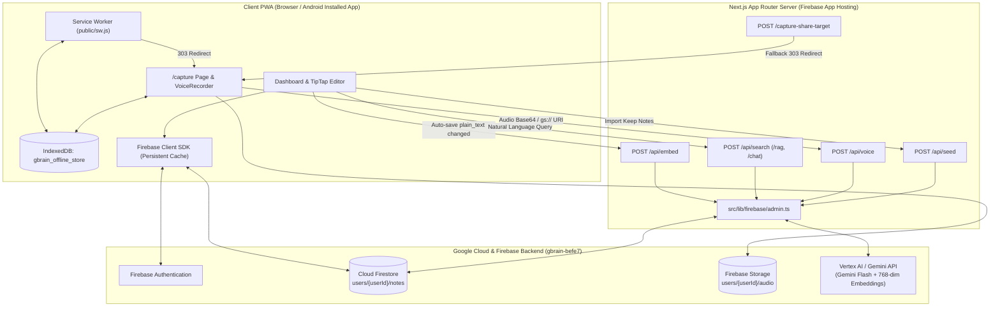

# System Design & Architecture Overview

## 1. Technology Stack

| Layer | Technology | Purpose |
| :--- | :--- | :--- |
| **Framework** | Next.js `16.4.1` (App Router, React `19.3`, TypeScript `5`) | Full-stack web application and API routes (`--webpack` build mode) |
| **Styling & UI** | Tailwind CSS `v4` + DaisyUI `v5` | Responsive dark-first styling, masonry/grid cards, modals, and badges |
| **Rich Text Editor** | TipTap (`@tiptap/react`, `@tiptap/starter-kit`, `@tiptap/pm` `v3.32`) | Block-based rich text editing with JSON + plain-text serialization |
| **Authentication** | Firebase Auth (`firebase/auth`) | Client-side Email/Password & Google OAuth authentication |
| **Database** | Cloud Firestore (`firebase/firestore` & `@google-cloud/firestore`) | Multi-tab offline-persistent client SDK + ADC-authenticated Admin SDK |
| **Media Storage** | Firebase Storage (`firebase/storage`) | User-isolated voice memo audio blob storage (`users/{userId}/audio/*`) |
| **Client Offline DB** | Browser IndexedDB (`gbrain_offline_store`) | Crash-safe 1s voice recording chunks (`voice_drafts`) & SW share handoff (`shared_media`) |
| **AI & Embeddings** | Google GenAI SDK (`@google/genai`) & Vertex AI (`@google-cloud/vertexai`) | `text-embedding-004` / `gemini-embedding-001` (768-dim) & Gemini Flash synthesis/multimodal audio |
| **Hosting** | Firebase App Hosting ([`apphosting.yaml`](file:///Users/gustavo/dev/projects/gBrain/apphosting.yaml)) | Serverless Cloud Run-backed Next.js hosting (`minInstances: 0`, `maxInstances: 2`, `1024MiB` RAM) |

---

## 2. High-Level System Architecture



---

## 3. Repository & Directory Structure

```text
gBrain/
├── AGENTS.md                        # AI coding agent instructions, rules, and workflow
├── README.md                        # Project overview, setup, and documentation index
├── apphosting.yaml                  # Firebase App Hosting runtime & env configuration
├── firebase.json                    # Firebase CLI rules mapping
├── firestore.rules                  # Firestore security rules (strict userId isolation)
├── storage.rules                    # Firebase Storage rules (userId audio isolation, 25MB limit)
├── data/
│   └── lords_favor_restoration_notes.md # Exported Google Keep notes for /api/seed
├── docs/                            # Persistent project knowledge base
│   ├── product/                     # Vision, target users, user journeys, and features
│   ├── architecture/                # System design, data models, security, and AI pipelines
│   └── stages/                      # Staged implementation plans and completed history
├── public/
│   ├── manifest.json                # PWA manifest, shortcuts, and Web Share Target config
│   ├── sw.js                        # Service Worker intercepting share-target POSTs
│   └── icons/                       # PWA maskable SVG icons (192x192, 512x512)
└── src/
    ├── app/
    │   ├── layout.tsx               # Root HTML shell, metadata, PWA registration
    │   ├── page.tsx                 # Landing/Auth gate redirecting to /dashboard
    │   ├── dashboard/page.tsx       # Protected route rendering NotesDashboard
    │   ├── capture/page.tsx         # Universal text/link/audio capture & voice-append UI
    │   ├── capture-share-target/    # Server-side fallback route for Web Share Target POSTs
    │   └── api/
    │       ├── embed/route.ts       # Generates & persists 768-dim note embeddings
    │       ├── search/route.ts      # Hybrid findNearest vector search + Gemini RAG synthesis
    │       ├── rag/route.ts         # Re-exports POST from /api/search
    │       ├── chat/route.ts        # Re-exports POST from /api/search
    │       ├── voice/route.ts       # Multimodal audio transcription, summary & note creation
    │       └── seed/route.ts        # Batch parser & embedding seeder for Keep markdown
    ├── components/
    │   ├── auth/LoginForm.tsx       # Email/Password, Google Sign-In & Demo mode login UI
    │   ├── dashboard/               # NotesDashboard.tsx (Omnibar, grid, tabs, voice cards)
    │   ├── editor/TipTapEditor.tsx  # Rich block editor with debounced auto-save
    │   ├── pwa/                     # ServiceWorkerRegister.tsx
    │   ├── search/                  # ConversationalSearch.tsx (AI Q&A + source citations)
    │   └── voice/VoiceRecorder.tsx  # WakeLock, audio visualizer, IndexedDB chunking, upload
    ├── context/
    │   └── AuthContext.tsx          # React Auth context with localStorage fast-hydration
    ├── lib/
    │   ├── firebase/client.ts       # Client Firebase app, Auth, Persistent Firestore, Storage
    │   ├── firebase/admin.ts        # Server Admin Firestore, Vertex AI, GenAI & fallbacks
    │   ├── notes/notes-service.ts   # CRUD & real-time subscription for users/{userId}/notes
    │   └── voice/voice-draft-store.ts # IndexedDB wrapper for voice drafts & shared media
    └── types/
        └── note.ts                  # Core Note TypeScript interface
```

---

## 4. Client vs. Server Responsibilities

### Client Side (`src/lib/firebase/client.ts` & `src/lib/notes/notes-service.ts`)
* Handles all interactive note reads (`onSnapshot`), note creations/edits (`setDoc` with `{ merge: true }`), and note deletions (`deleteDoc`) directly against the user's `users/{userId}/notes` subcollection using the authenticated Firebase Client SDK.
* Configured with `persistentLocalCache({ tabManager: persistentMultipleTabManager() })` so the dashboard loads instantaneously from IndexedDB cache and works across multiple browser tabs.
* Uploads raw voice recordings directly to Firebase Storage (`users/{userId}/audio/voice_<timestamp>.<ext>`) with a 4-second race timeout so slow connections never block transcription.

### Server Side (`src/lib/firebase/admin.ts` & `src/app/api/*`)
* Authenticates to Google Cloud services using **Application Default Credentials (ADC)** on Firebase App Hosting (or `GEMINI_API_KEY` / `GOOGLE_API_KEY` when provided).
* Executes privileged or compute-heavy operations:
  * Calling Vertex AI / Gemini APIs for 768-dimensional vector embeddings (`generateTextEmbedding`).
  * Writing `FieldValue.vector(embedding)` fields to Firestore so Firestore's vector index can index the note.
  * Executing `notesRef.findNearest(...)` vector similarity queries on `users/{userId}/notes`.
  * Running multimodal audio transcription & summarization (`processMultimodalVoiceMemo`) and RAG answer synthesis (`generateRAGAnswer`).

